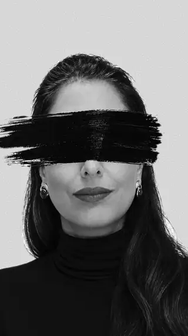
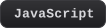
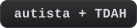
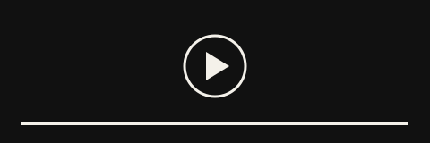
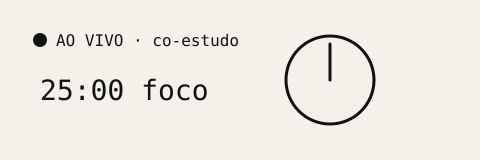

 

# Tatiana Barros

      

[🇧🇷 Português](#-português) · [🇺🇸 English](#-english)

[🍴 Forks por tema · Forks by theme](FORKS.md)

---

## 🇧🇷 Português

Uso código pra transformar ideias em coisas que dá pra ver, explorar e sentir. Meu trabalho aqui gira em torno de três frentes: arte gerada por código, dados públicos que viram mapas e histórias, e experiências interativas no navegador.

Sou autista e tenho TDAH, e isso molda o meu jeito de criar e documentar: em ritmos sustentáveis, com clareza e com empatia.

### Onde eu escrevo e crio

<b>🧬 O que eu escrevo na Mídia Ninja</b>

 
Contos que misturam tecnologia, ficção científica e vida real.
  

<b>🎥 O que rola no YouTube</b>

 
Estudo em público (#StudyWithMe): tecnologia, neurodivergência, ficção científica e jeitos de aprender pensados pra quem tem dificuldade cognitiva, emocional ou estrutural no processo.
  

<b>🔴 O que rola nas lives da Twitch</b>

 
Co-estudo ao vivo, projetos open source sendo construídos na hora, conversas sobre carreira tech e criatividade.
  

---

## 🇺🇸 English

I use code to turn ideas into things you can see, explore and feel. My work here follows three threads: art made with code, open data turned into maps and stories, and interactive experiences in the browser.

I'm autistic and have ADHD, and that shapes how I create and document: at sustainable rhythms, with clarity and empathy.

### Where I write and create

<b>🧬 What I write at Mídia Ninja</b>

 
Short stories (in Portuguese) that blend technology, science fiction and real life.
  

<b>🎥 What's on YouTube</b>

 
Studying in public (#StudyWithMe): technology, neurodivergence, science fiction and ways of learning for people who face cognitive, emotional or structural barriers.
  

<b>🔴 What happens on the Twitch streams</b>

 
Live co-study sessions, open source projects built on the spot, and conversations about tech careers and creativity.
  

---

<picture>
  <source media="(prefers-color-scheme: dark)" srcset="https://raw.githubusercontent.com/tatyquebralayout/tatyquebralayout/output/pacman-contribution-graph-dark.svg">
  <source media="(prefers-color-scheme: light)" srcset="https://raw.githubusercontent.com/tatyquebralayout/tatyquebralayout/output/pacman-contribution-graph.svg">
  
</picture>

 obrigada pela visita · thanks for stopping by

